<!--
  devillish404 · profile README
  The SVGs in assets/ are generated by scripts/render.py from data.json.
  Edit data.json, then run: python3 scripts/render.py
-->

<picture>
  <source media="(max-width: 600px) and (prefers-color-scheme: dark)" srcset="assets/header-compact-dark.svg">
  <source media="(max-width: 600px) and (prefers-color-scheme: light)" srcset="assets/header-compact-light.svg">
  <source media="(prefers-color-scheme: dark)" srcset="assets/header-dark.svg">
  <source media="(prefers-color-scheme: light)" srcset="assets/header-light.svg">
  
</picture>

I'm a third-year Computer Science student at BITS Pilani. Most of what I've shipped so far is product engineering: the official BOSM 2026 website (BITS Pilani's sports fest) and a real-time 1v1 coding-duel platform. The work I'm proudest of is about **correctness when things go wrong**: a payments engine you can `kill -9` mid-payment and it still won't pay twice.

That's the thread I'm following down the stack, toward low-level C++ and the internals of LLM inference. I'm aiming at **ML and systems** roles.

<br>

<picture>
  <source media="(max-width: 600px) and (prefers-color-scheme: dark)" srcset="assets/audit-compact-dark.svg">
  <source media="(max-width: 600px) and (prefers-color-scheme: light)" srcset="assets/audit-compact-light.svg">
  <source media="(prefers-color-scheme: dark)" srcset="assets/audit-dark.svg">
  <source media="(prefers-color-scheme: light)" srcset="assets/audit-light.svg">
  
</picture>

<sub>Every line on this page maps to a repo, a commit count or a public API. Anything I can't back up yet is marked <b>PENDING</b> rather than listed as a skill. That rule comes from PayPilot, below.</sub>

<br>

## `❯ ls ~/shipped`

### `paypilot/` · fail-closed accounts payable

**[devillish404/paypilot](https://github.com/devillish404/paypilot)** · Python · SQLite · ContextCon hackathon

An accounts-payable engine for mid-size Indian logistics (3PL) companies. It takes a request (post these bank lines, pay these invoices, reconcile this statement) and checks every line against the client's own vendor master, purchase orders and payment history. Deterministic checks catch duplicate invoices, PO mismatches, look-alike vendors and bank-detail changes. Payments wait for human approval and go out through a provider interface: a deterministic `FakeProvider`, plus a RazorpayX Payouts test-mode adapter. Every item ends in exactly one outcome: `POSTED`, `PAID`, `HELD`, `CANNOT_VERIFY`, `REJECTED` or `PAYMENT_UNCERTAIN`. No LLM makes any decision.

How it stays correct:

- **At-most-once payments, even through crashes.** Item state changes are compare-and-swap on `(state, version)`, and the audit row is written in the same transaction. Named crash points (`PAYPILOT_CRASH_AT=…`) kill the process at an exact step, and `resume` picks up without paying twice.
- **"I don't know" is a state, not an error.** A lost provider reply becomes `PAYMENT_UNCERTAIN` and blocks until reconciled.
- **Books that balance.** A double-entry journal, plus `audit verify` to replay every decision. A bank return after a confirmed payout posts a `REVERSAL` and contains the vendor.
- **Approvals that can go stale.** Each approval is bound to a hash of the decision. If the data underneath changes, the approval is refused.
- **Untrusted input stays inert.** Vendor text is escaped and stripped of control and bidi characters before it reaches the terminal.
- **Cost ledger.** Budget is reserved before every paid API call. Unpriced calls are recorded as `UNKNOWN`, not zero.

A 21-scene demo walks through all of it: month-end posting, duplicate and fraud attempts, a `kill -9` mid-payment, a lost reply, a bank return and a statement reconcile. A read-only dashboard shows the books live.

### `code-duel/` · real-time 1v1 coding duels

private org · Next.js · Express · Socket.IO · Redis · PostgreSQL · Go · Docker

A platform for live one-on-one programming duels inside a timed contest. It runs as five services:

- **Frontend** (Next.js, Socket.IO, better-auth): the matchmaking queue, a duel arena with an editor and language picker, and a live leaderboard.
- **Backend** (Express, Drizzle + PostgreSQL, Redis): the duel lifecycle over WebSockets (join/leave queue, run, submit, time-outs, disconnects, back-outs), with metrics and end-to-end tests.
- **Matchmaking service** (TypeScript, Redis): pairs queued players by rating early in a contest and by contest score later, and waits briefly for a closer opponent before accepting a worse match.
- **Remote code execution engine** (Go): judges C++, Java, Python and PyPy in Docker containers with time and memory limits and testlib checkers. Each language has a warm container pool that grows and shrinks with Redis queue depth. Ships with a load-test harness.
- **Admin portal** (Django).

Scoring is Elo-based. The winner earns a minimum plus *K · (1 − expected score)*, so upsets pay more. Streak and speed bonuses are added, repeated wrong submissions are penalised, and the leaderboard is a Redis sorted set.

### `bosm/` · BOSM 2026 website

private org repo · React · TanStack Router & Query · Zustand · GSAP · Firebase

The official website of BOSM 2026, BITS Pilani's inter-college sports festival. Besides the public pages (sports, archives, guide), it runs **registration and payments** for three roles: participants, team captains and college representatives. Each role has its own dashboard, team management and a multi-step payment flow (bill → mode → confirm → redirect). Role-based route guards control access, and they're covered by tests. The site is a monorepo with a shared shadcn/ui package and a generated, typed API client.

### `entity-res/` · Amazon ML Challenge

**[devillish404/Amazon_ML_Challenge](https://github.com/devillish404/Amazon_ML_Challenge)** · Python · scikit-learn · XGBoost

Business entity resolution: find the same business across three noisy sources, using only the supplied data (no external lookups). The pipeline normalizes names and addresses, including transliterating Indic scripts. Blocking then generates candidate pairs, and a gradient-boosted classifier (HistGradientBoosting or XGBoost) scores them. The match threshold is tuned on an entity-level split against the competition's macro F<sub>0.5</sub>. Diagnostic scripts measure blocking recall and surface the true pairs it missed.

<br>

## `❯ devillish404 --help`

```text
USAGE
  devillish404 [--fail-closed] <problem>

SHIPS WITH
  react, tanstack, zustand   frontend (BOSM)
  next.js                    frontend
  python, sqlite             backend, data (PayPilot)
  c++                        contest code (Codeforces)
  go                         a little

LEARNING  (no project yet, so no claim)
  c++    the low-level side: memory, layout,
         concurrency, performance
  llm    transformer internals, inference

COMPETITIVE PROGRAMMING
  codeforces   NideshCanCode · 1472 · specialist
```

## `❯ cat ~/.plan`

```text
[ ] order-book-engine
    a limit order book + matching engine in C++20.
    price-time priority, latency measured not guessed.
    when it ships, the struct's __pad becomes a field.

[ ] then: transformer internals, from weights to tokens.
```

<details>
<summary><code>❯ curl -I localhost/systems-engineer</code></summary>

```http
HTTP/1.1 404 Not Found
Server: devillish404
X-Status: compiling
Retry-After: order-book-engine
X-Note: 16 bytes of padding are reserved for it, see header
```

</details>

## `❯ finger devillish404`

```text
Login: devillish404                  Name: Nidesh Ahilan
Directory: /bits-pilani/cs/year-3    Shell: /bin/bash
Mail: nidesh.ahilan@proton.me
Plan: see ~/.plan above
```

**[LinkedIn](https://www.linkedin.com/in/nidesh-ahilan-4aa77131a/)** · **[Email](mailto:nidesh.ahilan@proton.me)** · **[Codeforces](https://codeforces.com/profile/NideshCanCode)**

<br>

<picture>
  <source media="(prefers-color-scheme: dark)" srcset="assets/footer-dark.svg">
  <source media="(prefers-color-scheme: light)" srcset="assets/footer-light.svg">
  
</picture>
