<!--
  devillish404 · profile README
  The SVGs in assets/ are generated by scripts/render.py from data.json.
  Edit data.json, then run: python3 scripts/render.py
-->

<picture>
  <source media="(max-width: 600px) and (prefers-color-scheme: dark)" srcset="assets/header-compact-dark.svg">
  <source media="(max-width: 600px) and (prefers-color-scheme: light)" srcset="assets/header-compact-light.svg">
  <source media="(prefers-color-scheme: dark)" srcset="assets/header-dark.svg">
  <source media="(prefers-color-scheme: light)" srcset="assets/header-light.svg">
  
</picture>

I'm a third-year Computer Science student at BITS Pilani. Most of what I've shipped so far is product engineering: the official website of BOSM, BITS Pilani's sports fest, and a 1v1 Codeforces duel platform. The work I'm proudest of is about **correctness when things go wrong**: a payments engine you can `kill -9` mid-payment and it still won't pay twice.

That's the thread I'm following down the stack, toward low-level C++ and the internals of LLM inference. I'm aiming at quant developer, systems and ML roles.

<br>

<picture>
  <source media="(max-width: 600px) and (prefers-color-scheme: dark)" srcset="assets/audit-compact-dark.svg">
  <source media="(max-width: 600px) and (prefers-color-scheme: light)" srcset="assets/audit-compact-light.svg">
  <source media="(prefers-color-scheme: dark)" srcset="assets/audit-dark.svg">
  <source media="(prefers-color-scheme: light)" srcset="assets/audit-light.svg">
  
</picture>

<sub>Every line on this page maps to a repo, a commit count or a public API. Anything I can't back up yet is marked <b>PENDING</b> rather than listed as a skill. That rule comes from PayPilot, below.</sub>

<br>

## `❯ ls ~/shipped`

### `paypilot/` · fail-closed accounts payable

**[devillish404/paypilot](https://github.com/devillish404/paypilot)** · Python · SQLite · team of 3 · hackathon prototype

An accounts-payable engine for mid-size Indian logistics companies. It matches bank lines and invoices to vendors, runs deterministic checks, queues payments for human approval, pays through a provider interface (a deterministic `FakeProvider`, plus a RazorpayX test-mode adapter) and keeps books an auditor can replay. It has one rule: **if it can't prove something, it stops.**

What made it hard:

- **At-most-once payments, even through crashes.** Every item moves through a state machine updated with compare-and-swap on `(state, version)`, and the audit row is written in the same transaction. Named crash points (`PAYPILOT_CRASH_AT=…`) kill the process at an exact step, and `resume` picks up without paying twice.
- **"I don't know" is a state, not an error.** A lost provider reply becomes `PAYMENT_UNCERTAIN` and blocks until reconciled. Only a failed *read-only* lookup is safe to retry.
- **Books that balance.** A double-entry journal, plus `audit verify` to replay every decision. A bank return after a confirmed success posts a `REVERSAL` and contains the vendor.
- **Approvals that can go stale.** An approval is bound to a hash of the decision it approved. If the data underneath changes, the approval is refused.
- **Untrusted text is shown, never interpreted.** Invoice text goes through markup escaping and control/bidi-character stripping, so a vendor name can't forge a terminal line.
- **Cost ledger.** Budget is reserved *before* every paid API call. A cost that can't be priced is recorded as `UNKNOWN`, not zero.

**My part:** 42 of the repo's 70 commits. I wrote the design plan, the core (config, DB, state machine, journal, resumable pipeline), approvals, payments and recovery, reconciliation, the CLI and the read-only dashboard. The 21-scene demo kills the process mid-payment, loses a provider reply and stages a bank-change fraud attempt, all against the FakeProvider in about two minutes.

### `bosm/` · official website of BOSM

React · TanStack · Zustand · private repo

The official website of **BOSM**, BITS Pilani's annual inter-college sports festival. I was one of the leads on the frontend team, and the edition the site served brought in **₹80L+ in revenue**.

### `code-duel/` · head-to-head Codeforces

private repo

1v1 duels on Codeforces problems, ranked by **our own Elo system**: your duel rating moves with every duel you win or lose, separate from your Codeforces rating.

### `entity-res/` · Amazon ML Challenge

**[Amazon_ML_Challenge](https://github.com/devillish404/Amazon_ML_Challenge)** · Python · scikit-learn · XGBoost

Business entity resolution: find the same business across three noisy sources. The pipeline has two stages. Normalization and blocking cut the candidate pairs, then a gradient-boosted pair classifier (HistGradientBoosting or XGBoost) scores them on macro F<sub>0.5</sub>. **My part:** the Indic-script transliteration and normalization, and the blocking-analysis scripts for finding the pairs that blocking missed.

<br>

## `❯ devillish404 --help`

```text
USAGE
  devillish404 [--fail-closed] <problem>

SHIPS WITH
  react, tanstack, zustand   frontend (BOSM)
  next.js                    frontend
  python, sqlite             backend, data (PayPilot)
  c++                        contest code (Codeforces)
  go                         a little

LEARNING  (no project yet, so no claim)
  c++    the low-level side: memory, layout,
         concurrency, performance
  llm    transformer internals, inference

COMPETITIVE PROGRAMMING
  codeforces   NideshCanCode · 1472 · specialist
```

## `❯ cat ~/.plan`

```text
[ ] order-book-engine
    a limit order book + matching engine in C++20.
    price-time priority, latency measured not guessed.
    when it ships, the struct's __pad becomes a field.

[ ] then: transformer internals, from weights to tokens.
```

<details>
<summary><code>❯ curl -I localhost/systems-engineer</code></summary>

```http
HTTP/1.1 404 Not Found
Server: devillish404
X-Status: compiling
Retry-After: order-book-engine
X-Note: 16 bytes of padding are reserved for it, see header
```

</details>

## `❯ finger devillish404`

```text
Login: devillish404                  Name: Nidesh Ahilan
Directory: /bits-pilani/cs/year-3    Shell: /bin/bash
Plan: see ~/.plan above
```

**[Codeforces](https://codeforces.com/profile/NideshCanCode)**
<!-- add when ready: · **[LinkedIn](URL)** · **[Email](mailto:ADDRESS)** -->

<br>

<picture>
  <source media="(prefers-color-scheme: dark)" srcset="assets/footer-dark.svg">
  <source media="(prefers-color-scheme: light)" srcset="assets/footer-light.svg">
  
</picture>
